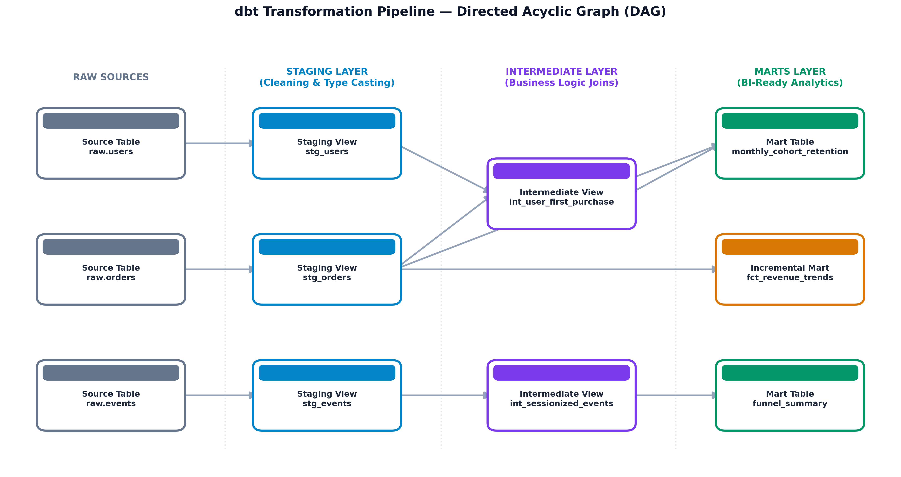
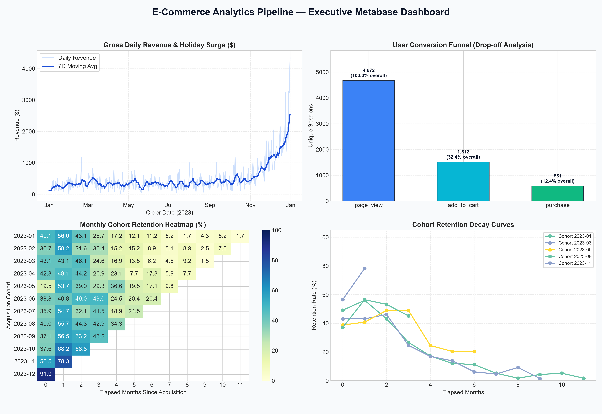
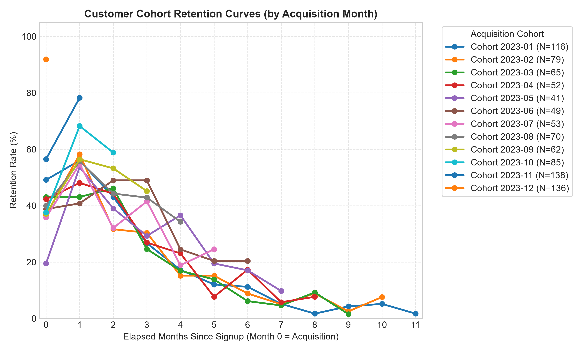
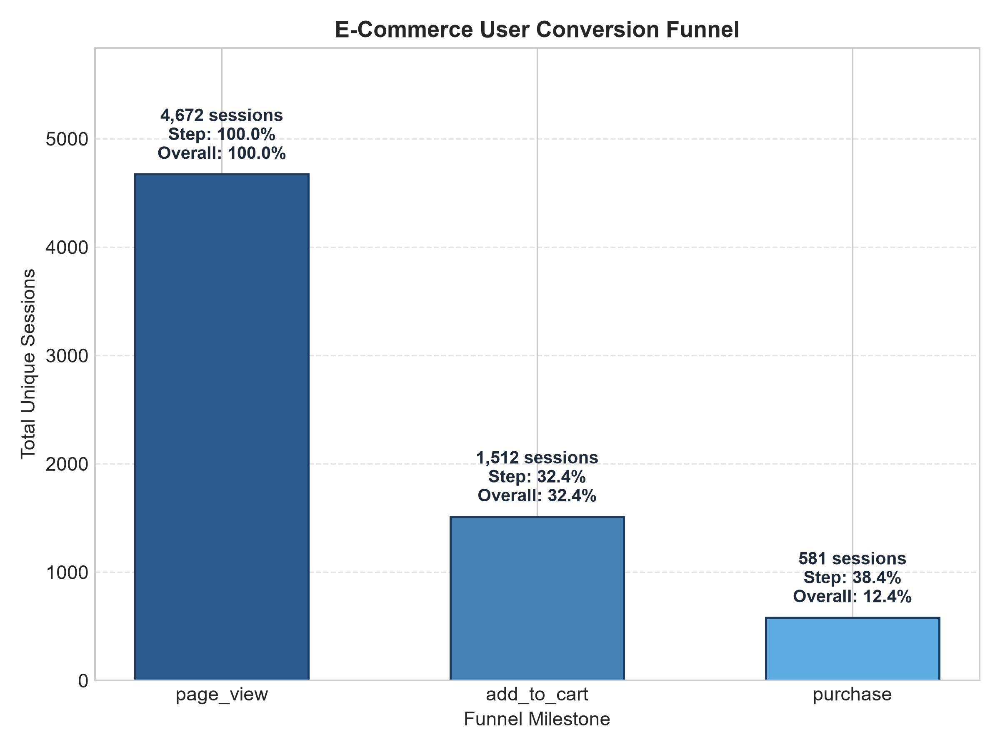
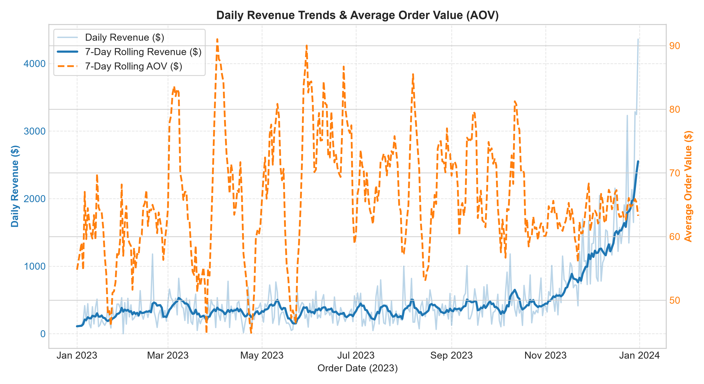

# messy-to-marts: End-to-End Analytics Pipeline with SQL, dbt & BI Dashboard

[](https://github.com/GurutejaReddy-04/messy-to-marts/actions/workflows/dbt_ci.yml)
[](https://github.com/GurutejaReddy-04/messy-to-marts/actions/workflows/dbt_scheduled.yml)

A dbt pipeline on PostgreSQL that transforms raw e-commerce event data into analysis-ready marts for a Metabase dashboard, including CI/CD and automated tests.

---

## Executive Summary & TL;DR

- **End-to-End Data Lifecycle:** Ingests raw multi-table e-commerce data with real-world messiness (typo-variant user duplicates, late-arriving dimensions, conflicting retry submissions, negative entry glitches, non-UTC timestamps), cleanses and transforms it through staging and intermediate layers, and materializes analysis-ready marts.
- **Incremental Data Modeling & Deletion Healing:** Implements an incremental merge fact model (`fct_revenue_trends`) that scales efficiently with daily transaction volume without requiring full table rebuilds, incorporating a configurable rolling lookback window (default 7 days via `revenue_lookback_days`). In-scope dates union target table dates (`{{ this }}`), automatically healing and zeroing out records whose source transactions were cancelled, refunded, or deleted.
- **Data Quality Tests:** Uses 68 dbt tests (60 generic column assertions + 8 custom singular SQL business logic tests) verifying customer retention bounds (0–100%), dense cohort spine completeness, realized revenue reconciliation, timestamp causality, completed order integrity, session durations ≤ 24 hours, and monotonic funnel progression (purchases ≤ cart adds ≤ page views).
- **Automated CI/CD & Nightly Scheduling:** GitHub Actions workflows execute granular, auditable steps (connection validation, compilation, model execution, test assertions, and `sqlfluff` style linting across models and tests) against an ephemeral PostgreSQL 16 service container on every pull request and nightly at 05:00 UTC as an integration health check.
- **Schema Change Isolation:** Isolated schema changes: a column rename (`order_value` to `order_amount`) only required updating the `stg_orders` staging model.

---

## Architecture & Data Lineage

Pipeline Architecture:

```text
Raw Synthetic Data (users.csv, orders.csv, events.csv with deliberate messiness)
         │
         ▼
PostgreSQL Warehouse (`raw` schema: raw.users, raw.orders, raw.events)
         │
         ▼
dbt Staging Layer (`public_staging`)
  ├── stg_users   : Typo-variant email deduplication, null filtering, date parsing
  ├── stg_orders  : Order retry deduplication, negative value filtering, UTC timestamp parsing
  └── stg_events  : Session validation, local timestamp parsing (timezone mismatch noted)
         │
         ▼
dbt Intermediate Layer (`public_intermediate`)
  ├── int_user_first_purchase : First purchase date, lifetime orders, cumulative customer spend
  └── int_sessionized_events  : Event aggregation, session duration, deepest funnel step
         │
         ▼
dbt Marts Layer (`public_marts`)
  ├── monthly_cohort_retention : Acquisition cohort retention matrices across elapsed months
  ├── funnel_summary           : Step-to-step and overall funnel conversion rates
  └── fct_revenue_trends       : Daily revenue, transaction volume, and AOV (Incremental Model)
         │
         ├──► dbt Tests (68 generic and custom singular tests executed automatically)
         ├──► GitHub Actions CI (Automated build, test, and sqlfluff lint on push/PR)
         ├──► GitHub Actions Schedule (Nightly unattended CI integration health check at 05:00 UTC)
         └──► Metabase BI Dashboard (Direct queries against marts layer only)
```

### dbt Directed Acyclic Graph (DAG) Lineage



---

## Tech Stack

| Component | Tool / Technology | Purpose |
| :--- | :--- | :--- |
| **Data Warehouse** | PostgreSQL 16 | Relational data warehouse hosting `raw`, `staging`, `intermediate`, and `marts` schemas |
| **Transformation** | dbt-core 1.12.5 / dbt-postgres 1.11.0 | Modular SQL modeling, incremental processing, documentation, and data testing |
| **Synthetic Data Generator** | Python 3.11, Faker, psycopg2 | Generation of realistic datasets with non-uniform distributions and deliberate messiness |
| **Linter** | SQLFluff | Automated SQL syntax, CTE structure, and formatting enforcement |
| **Continuous Integration** | GitHub Actions | Automated end-to-end execution against an ephemeral PostgreSQL service container |
| **Scheduling** | GitHub Actions Cron | Unattended nightly pipeline execution (`0 5 * * *`) |
| **BI Dashboard** | Metabase | Business metric visualization (retention curves, funnels, revenue trends) |

---

## Synthetic Data Specification & Messiness Audit

The raw dataset reflects multi-year transactional and clickstream behaviors generated with non-uniform seasonal and day-of-week patterns:

| Table | Row Count | Injected Messiness / Characteristic | Injected Rate / Actual Count |
| :--- | :--- | :--- | :--- |
| **`users`** | 1,000 | Typo-variant duplicate registrations (domain typos like `@gmial.com`, `@yaho.com`, and Gmail local-part dot variations) | 40 rows (4.0%) |
| | | Null `signup_date` | 15 rows (1.5%) |
| | | Null `country` (nullable by design) | 15 rows (1.5%) |
| | | Signup Date Distribution | Clustered non-uniformly with acquisition peaks in Jan (117) and Nov/Dec (285) |
| **`orders`** | 3,500 | Orphaned `user_id` (late-arriving customer dimensions) | 51 rows (1.46%) |
| | | Negative or zero `order_amount` | 37 rows (1.06%)\* |
| | | Duplicate `order_id` pairs with conflicting status/value/date (retry bugs) | 35 pairs (1.00%) |
| | | Timestamp standard | UTC ISO 8601 (`YYYY-MM-DDTHH:MM:SSZ`), strictly bounded within acquisition dates and year 2023 |
| | | Day of Week Distribution | Weekend elevated: Mon (423), Tue (423), Wed (463), Thu (395), Fri (542), Sat (623), Sun (631) |
| **`events`** | 15,000 | Orphaned `user_id` | 172 rows (1.15%) |
| | | Funnel progression | `page_view` (11,997), `add_to_cart` (2,422), `purchase` (581) with chronological event sequencing |
| | | Timestamp standard | Local time (`YYYY-MM-DD HH:MM:SS`), unadjusted for UTC |

\* *Data spec note: The 1.06% negative/zero order rate resulted from an intentional interaction between the base entry glitch generator (27 rows / 0.77%) and duplicate retry cancellations setting order_amount to 0.00 USD (10 rows).*

### Anomaly Design Rationale

The synthetic data generation framework deliberately introduces real-world messiness to test data governance and transformation resilience. The specific frequencies were chosen as operational design benchmarks authored for this synthetic dataset:

- **4.0% Typo-Variant User Duplicates:** Reflects typical customer signup friction across mobile and desktop forms (omitted dots in Gmail handles, common domain typos like `@gmial.com`, `@yaho.com`, `@outlok.com`, `@hotmial.com`, or accidental double-submissions). The generator guarantees exactly 960 distinct base user identities, targeting deterministic syntactic variations so staging safely resolves 100% of injected duplicates without heuristic local-part fuzzy matching that risks merging distinct legitimate individuals.
- **1.5% Null Registration Dates:** Simulates legacy user records migrated from early un-instrumented signup forms prior to strict timestamp capture.
- **1.5% Null Geographic Country:** Reflects opt-out privacy settings or unresolved IP geolocation lookups in modern compliance frameworks.
- **1.46% Orphaned Order User IDs:** Models late-arriving dimensions in decoupled event-driven architectures where transactional databases stream purchase events before CRM master identity replicas synchronize.
- **1.06% Negative or Zero Order Amounts:** Simulates payment gateway refund processing glitches, test transactions mistakenly written to production logs, and promotional zero-dollar checkout orders.
- **1.00% Conflicting Duplicate Orders:** Models checkout client retry race conditions when consumers double-click purchase buttons under network latency, generating identical transaction IDs with conflicting status or timestamps.
- **1.15% Orphaned Event User IDs:** Simulates unauthenticated or anonymous visitor sessions that browse products before account registration or login.

### Remediation Mapping Matrix

Every injected anomaly is systematically handled at a specific transformation layer:

| Injected Anomaly / Defect | Ingestion Table | Resolving Model | Transformation Technique & Resolution Strategy |
| :--- | :--- | :--- | :--- |
| **Typo Duplicate Users** | `raw.users` | `stg_users` | Deterministic domain canonicalization + Gmail dot stripping; window ranking (`ROW_NUMBER() OVER (PARTITION BY normalized_email ORDER BY signup_at ASC)`) resolves 100% (40/40) of injected duplicates. |
| **Null `signup_date`** | `raw.users` | `stg_users` | Filtered out (`WHERE signup_date IS NOT NULL`) to preserve downstream cohort integrity; flagged as invalid registrations. |
| **Conflicting Duplicate Orders** | `raw.orders` | `stg_orders` | Deduplicated via window ranking prioritizing `order_status = 'completed'` and latest attempt timestamp. |
| **Negative / Zero Values** | `raw.orders` | `stg_orders` | Validated and filtered (`WHERE order_amount > 0.00`) to guarantee non-negative revenue calculations in marts. |
| **Orphaned User Orders** | `raw.orders` | `int_user_first_purchase` | Preserved in staging; inner joined against cleansed `stg_users` so only verified accounts drive cohort metrics. |
| **Out-of-Order Funnel Events** | `raw.events` | `int_sessionized_events`, `funnel_summary` | Enforces strict chronological milestone progression (`first_page_view_at <= first_add_to_cart_at <= first_purchase_at`). |
| **Timezone Inconsistencies** | `raw.events` | `stg_events` | Documented and cast to explicit client-local timestamps; day boundaries normalized for daily funnel aggregation. |

### Intentional Residual Anomalies

Certain real-world attributes are intentionally preserved downstream rather than artificially scrubbed:

1. **Nullable Country (`stg_users.country`):** Preserved as `NULL` for ~1.5% of records without artificial imputation. Imputing arbitrary defaults (e.g., `'Unknown'` or mode country) would distort geographic marketing analytics.
2. **Orphaned Raw Records:** Retained in the `raw` schema tables for auditability and observability reconciliation, validating that data engineers can measure pipeline attrition rates between raw ingestion and dimensional marts.

---

## Setup Instructions

### 1. Environment Setup

Create and activate the dedicated Conda environment:

```bash
# Create conda environment from specification
conda env create -f environment.yml

# Activate environment
conda activate analytics-pipeline
```

Alternatively, install dependencies via `pip`:

```bash
pip install dbt-core==1.12.5 dbt-postgres==1.11.0 psycopg2-binary sqlfluff Faker pytest pyyaml matplotlib seaborn pillow
```

### 2. Environment & Credential Configuration

Create a local environment configuration file from the template:

```bash
cp .env.example .env
```

Set your database password and optional host/port overrides in `.env` or your shell:

```bash
export DB_PASSWORD="your_secure_password"
```

All operational scripts (`load_raw_data.py`, `render_dashboard_charts.py`) and dbt profiles resolve credentials through centralized environment configuration (`db_config.py`). `db_config.py` automatically parses key-value pairs from `.env` on startup, while active shell environment variables take precedence. If credentials are not supplied, operations fail immediately with an explicit, secure error message.

### 3. Configure dbt Profile

Copy the template configuration file to `profiles.yml`:

```bash
cp profiles.example.yml profiles.yml
```

The profile reads `DB_PASSWORD` directly from the environment without storing hardcoded credentials on disk.

### 4. Database Provisioning & Raw Data Ingestion

Ensure PostgreSQL is running locally (e.g. via host service or Docker container):

```bash
# Optional: Spin up PostgreSQL 16 container
docker run --name postgres-warehouse \
  -e POSTGRES_USER=postgres \
  -e POSTGRES_PASSWORD=your_secure_password \
  -e POSTGRES_DB=analytics_pipeline \
  -p 5432:5432 -d postgres:16
```

Generate synthetic raw datasets and load them into PostgreSQL:

```bash
# Generate synthetic raw CSV files with deliberate messiness
python generate_raw_data.py

# Ingest raw CSV datasets into PostgreSQL under the 'raw' schema (safe TRUNCATE by default)
python load_raw_data.py

# Optional: To perform a destructive drop-and-recreate of raw tables:
python load_raw_data.py --drop-tables
```

> [!NOTE]
> **Ephemeral CI Verification vs. Persistent Production Warehouse:**
> In GitHub Actions CI, jobs execute against an ephemeral PostgreSQL service container where `load_raw_data.py` provisions seed tables for complete integration verification. In persistent production warehouses, `load_raw_data.py` uses `CREATE TABLE IF NOT EXISTS` and `TRUNCATE TABLE` by default to safeguard against accidentally cascading drops of dependent views or constraints. Destructive schema drops require explicit `--drop-tables` or `--force-reset` flags.

### 5. Verify Connection

```bash
dbt debug --profiles-dir .
```

---

## Running the Pipeline

Execute the full transformation pipeline and test suite:

```bash
# Build all staging, intermediate, and marts models and execute tests
dbt build --profiles-dir .

# Run models only
dbt run --profiles-dir .

# Execute data quality test suite only (68 tests)
dbt test --profiles-dir .

# Lint SQL models against style rules
sqlfluff lint models/
```

### Generating and Viewing dbt Documentation

```bash
# Generate documentation catalog and lineage graphs
dbt docs generate --profiles-dir .

# Serve documentation locally on http://localhost:8080
dbt docs serve
```

---

## Testing Strategy

The test suite enforces 68 data validation tests (60 generic column assertions + 8 custom singular tests) defined in [`TEST_PLAN.md`](TEST_PLAN.md):

1. **Staging Layer (19 generic tests):**
   - Primary key uniqueness and not-null constraints on `stg_users.user_id`, `stg_orders.order_id`, and `stg_events.event_id`.
   - Not-null validation on downstream dependencies (`signup_date`, `order_date`, `session_id`, `event_name`, `event_timestamp`).
   - Missing fields allowed by design (`country`) are intentionally not asserted as not-null.
2. **Intermediate Layer (24 generic + 3 custom singular tests):**
   - Column assertions on session identifiers, event metrics, sequential funnel milestone flags (`has_sequential_cart`, `has_sequential_purchase`), and first purchase timestamps.
   - [`tests/test_session_duration_24h.sql`](tests/test_session_duration_24h.sql): Asserts session duration in `int_sessionized_events` is non-negative and ≤ 86,400 seconds (24 hours).
   - [`tests/test_first_purchase_after_signup.sql`](tests/test_first_purchase_after_signup.sql): Asserts that `first_purchase_at` in `int_user_first_purchase` strictly occurs after the customer's registration timestamp `signup_at` (UTC).
   - [`tests/test_first_purchase_status_completed.sql`](tests/test_first_purchase_status_completed.sql): Asserts that all customer initial purchase metrics strictly reference valid `completed` orders in `stg_orders`.
3. **Marts Layer (17 generic + 5 custom singular tests):**
   - [`tests/test_revenue_non_negative.sql`](tests/test_revenue_non_negative.sql): Asserts `total_revenue` and `average_order_value` in `fct_revenue_trends` are non-negative.
   - [`tests/test_revenue_excludes_non_completed_orders.sql`](tests/test_revenue_excludes_non_completed_orders.sql): Asserts daily revenue, order counts, distinct purchasing customers, and average order values in `fct_revenue_trends` reconcile exactly with completed orders in `stg_orders`, coalescing in-scope zero-completed dates to $0.00 / 0.
   - [`tests/test_retention_percentage_range.sql`](tests/test_retention_percentage_range.sql): Asserts `retention_pct` in `monthly_cohort_retention` falls within [0.00, 100.00]%.
   - [`tests/test_cohort_spine_completeness.sql`](tests/test_cohort_spine_completeness.sql): Asserts that `monthly_cohort_retention` includes all observed cohorts from month 0 up to the maximum dataset horizon without missing elapsed months, catching dropped cohorts or omitted zero-completed periods.
   - [`tests/test_funnel_monotonic.sql`](tests/test_funnel_monotonic.sql): Asserts conversion counts are monotonically non-increasing (purchases ≤ cart additions ≤ page views).
   - `accepted_values` on `funnel_summary.funnel_step` (`['page_view', 'add_to_cart', 'purchase']`).

---

## Automation & CI/CD

- **GitHub Actions CI Workflow ([`.github/workflows/dbt_ci.yml`](.github/workflows/dbt_ci.yml)):**
  - Triggers on every `push` and `pull_request` to `main`/`master`.
  - Provisions an ephemeral PostgreSQL 16 service container with an intentionally non-secret, fixed test credential (`ci_test_ephemeral_password`) scoped exclusively to the CI service container and job environment.
  - Ingests raw synthetic data via `load_raw_data.py --replace`.
  - Executes granular, independently auditable workflow steps:
    1. Connection validation (`dbt debug`)
    2. Model compilation (`dbt compile`)
    3. Model transformations (`dbt run`)
    4. Data quality assertions (`dbt test` — all 68 tests)
    5. Offline fallback parity verification (`python tests/test_fallback_parity.py`)
    6. Two-pass incremental source-deletion recovery validation (`python tests/test_incremental_deletion_recovery.py`)
    7. SQLFluff style linting (`sqlfluff lint models/ tests/`)
- **Nightly Scheduled Workflow ([`.github/workflows/dbt_scheduled.yml`](.github/workflows/dbt_scheduled.yml)):**
  - Triggers automatically via cron daily at 05:00 UTC (`0 5 * * *`) and on-demand via `workflow_dispatch` as a scheduled CI integration health check.
  - Provisions a clean ephemeral PostgreSQL container, loads synthetic test fixtures via `python load_raw_data.py --replace`, and executes the complete pipeline (`dbt debug`, `dbt compile`, `dbt run`, `dbt test`, and `sqlfluff lint models/ tests/`) to guarantee pipeline reproducibility from scratch on fresh infrastructure.

---

## Key Data Findings

Key metrics extracted directly from the marts tables:

1. **Conversion Funnel Metrics (`funnel_summary`):**
   - **Top-of-Funnel Sessions:** 4,672 visitor sessions.
   - **Add-to-Cart Conversion:** 1,512 sessions added items to cart (32.36% step conversion rate).
   - **Purchase Checkout Conversion:** 581 sessions completed an order (38.43% step conversion from cart; 12.44% overall conversion from page view).
2. **Cohort Retention Patterns (`monthly_cohort_retention`):**
   - January 2023 Cohort (N = 116): Month 0 acquisition activity is 49.14% (57 active users), rising to a repeat purchase peak of 56.03% in Month 1 (65 active users), tapering to 43.10% in Month 2, 26.72% in Month 3, 17.24% in Month 4, and 1.72% by Month 8.
   - Dense Spine & Right-Censoring: All 12 monthly acquisition cohorts (946 cohorted users across 2023) maintain complete elapsed-month spines up to December 2023, preserving zero-retention periods (`0.00%`) while omitting unobserved future periods.
3. **Revenue Trends & Incremental Scaling (`fct_revenue_trends`):**
   - Daily gross completed revenue aggregates to $182,321.85 across 2,792 completed orders (362 active transaction days, 363 total tracked calendar dates, mean active day AOV $66.28).
   - Elevated transaction volume occurs on weekends (Saturday/Sunday generating 36.6% of weekly completed order volume) alongside pronounced Q4 holiday sales surges.
   - **Source Deletion Operational Model:** Deletions occurring within the rolling 7-day lookback window are automatically healed and zeroed out ($0.00 revenue / 0 orders) because `dates_in_scope` unions target table dates (`{{ this }}`) with staging. Historical deletions older than the lookback SLA are reconciled via standard on-demand full refresh (`dbt run --full-refresh --select fct_revenue_trends`).

---

## BI Dashboard (Metabase)

The business intelligence layer connects to PostgreSQL on `localhost:5432` (database `analytics_pipeline`, user `postgres`) filtered strictly to the **`public_marts`** schema. Pointing BI tools exclusively to the marts layer ensures stakeholders only query curated, tested, documented fact and dimension tables, preventing exposure of raw or un-cleansed upstream data.

### Reproducing the BI Dashboard in Metabase

1. **Launch Metabase:**
   Run Metabase locally via Docker:
   ```bash
   docker run -d -p 3000:3000 --name metabase metabase/metabase:latest
   ```
   Open `http://localhost:3000` in your browser and complete the initial account wizard.

2. **Connect PostgreSQL Data Source:**
   - **Database Type:** PostgreSQL
   - **Host:** `localhost` (or `host.docker.internal` if Metabase runs inside a container)
   - **Port:** `5432`
   - **Database Name:** `analytics_pipeline`
   - **Username / Password:** Configured credentials from `.env`
   - **Schema Filter:** Restrict table synchronization strictly to the **`public_marts`** schema.

3. **Explore Curated Analytical Marts:**
   The BI layer directly visualizes three validated fact and dimension tables:
   - `public_marts.monthly_cohort_retention`: Acquisition cohort retention matrices across elapsed months.
   - `public_marts.funnel_summary`: Milestone conversion counts and drop-off percentages.
   - `public_marts.fct_revenue_trends`: Daily aggregate revenue, order counts, and AOV.

### Programmatic Dashboard Chart Rendering & Provenance

To guarantee programmatic reproducibility and automated visual documentation without requiring an active Metabase server instance, the repository provides a programmatic rendering script:

```bash
python render_dashboard_charts.py
```

**Artifact Provenance:**
- This script connects directly to PostgreSQL via centralized `db_config`, queries the exact marts tables above, and programmatically renders publication-grade 300 DPI visualizations using `matplotlib` and `seaborn`.
- It deterministically writes the executive charts to `screenshots/`:
  - `screenshots/dashboard_cohort.png` (Customer Cohort Retention Curves)
  - `screenshots/dashboard_funnel.png` (E-Commerce Conversion Funnel)
  - `screenshots/dashboard_revenue.png` (Daily Revenue Trends & AOV)
  - `screenshots/dashboard_full.png` (Consolidated Executive Dashboard Overview)
- These rendered artifacts faithfully mirror the layout, color scheme, and metrics of the Metabase dashboard panels, providing an auditable, version-controlled baseline for stakeholder presentations.

### Executive Dashboard Overview

The executive dashboard consolidates key business metrics into a unified view:



---

### Key Dashboard Visualizations

#### 1. Customer Cohort Retention Curves
- **Source Table:** `public_marts.monthly_cohort_retention`
- **Axes:** X-axis = `month_number` (0 to 11), Y-axis = `retention_pct` (0% to 100%), Series = `cohort_month`.
- **Business Insight:** Tracks customer loyalty across acquisition cohorts over time. The January 2023 cohort (N = 116) achieves a peak repeat purchase rate of 56.03% in Month 1, declining to 26.72% in Month 3 and 1.72% in Month 8.



#### 2. E-Commerce Conversion Funnel
- **Source Table:** `public_marts.funnel_summary`
- **Axes:** X-axis = `funnel_step` (`page_view` → `add_to_cart` → `purchase`), Y-axis = `session_count`.
- **Business Insight:** Identifies friction in user purchasing flows. Of 4,672 browsing sessions, 32.36% (1,512 sessions) add items to cart, and 38.43% of cart sessions (581 sessions) convert into purchases, representing a 12.44% overall end-to-end conversion rate.



#### 3. Daily Revenue Trends & Average Order Value
- **Source Table:** `public_marts.fct_revenue_trends`
- **Axes:** X-axis = `order_date`, Primary Y-axis = `total_revenue` (USD), Secondary Y-axis = `average_order_value` (USD).
- **Business Insight:** Visualizes gross transaction velocity, highlighting weekend purchasing spikes (Saturday/Sunday generating 36.6% of weekly completed order volume) and Q4 holiday sales surges. Built as an incremental model for low-latency updates.



---

## Maintenance Flow Demonstration

A core architectural promise of modular analytics engineering is schema change isolation: when an upstream transactional database alters its column naming or structure, the modification is contained exclusively within the **staging layer** (`models/staging/`). Intermediate models, marts tables, and downstream BI dashboards require **zero modifications**.

### 1. The Upstream Breaking Change
An upstream source migration renamed the transactional monetary column in `raw.orders` (and `raw_data/orders.csv`) from `order_value` to `order_amount`.

### 2. Immediate Failure in Staging
Running `dbt run` immediately flagged the breaking change at the staging boundary while protecting downstream relations from silent corruption:

```text
16:45:46  1 of 8 START sql view model public_staging.stg_events .......................... [RUN]
16:45:46  2 of 8 START sql view model public_staging.stg_orders .......................... [RUN]
16:45:46  2 of 8 ERROR creating sql view model public_staging.stg_orders ................. [ERROR in 0.14s]
16:45:46  4 of 8 SKIP relation public_marts.fct_revenue_trends ........................... [SKIP]
16:45:46  6 of 8 SKIP relation public_intermediate.int_user_first_purchase ............... [SKIP]
16:45:46  7 of 8 SKIP relation public_marts.monthly_cohort_retention ..................... [SKIP]

[ERROR]: in model stg_orders (models/staging/stg_orders.sql)
  Database Error in model stg_orders (models/staging/stg_orders.sql)
  column "order_value" does not exist
  LINE 23: order_value,
```

### 3. The 1-Line Staging Adaptation
The change was resolved entirely within `models/staging/stg_orders.sql` by aliasing the renamed raw field back to the standardized internal identifier `order_value`:

```diff
 with raw_orders as (
     select
         order_id,
         user_id,
         order_date,
-        order_value,
+        -- Adapt to upstream raw column rename (order_amount -> order_value)
+        order_amount as order_value,
         order_status
     from {{ source('raw', 'orders') }}
 ),
```

### 4. Downstream Verification
Re-executing `dbt run` and `dbt test` proved that all downstream models and BI dashboards functioned without a single change:

```text
16:46:05  1 of 8 OK created sql view model public_staging.stg_events ..................... [CREATE VIEW in 0.25s]
16:46:05  2 of 8 OK created sql view model public_staging.stg_orders ..................... [CREATE VIEW in 0.16s]
16:46:05  3 of 8 OK created sql view model public_staging.stg_users ...................... [CREATE VIEW in 0.25s]
16:46:05  4 of 8 OK created sql incremental model public_marts.fct_revenue_trends ........ [MERGE 1 in 0.20s]
16:46:05  5 of 8 OK created sql view model public_intermediate.int_sessionized_events .... [CREATE VIEW in 0.12s]
16:46:05  6 of 8 OK created sql view model public_intermediate.int_user_first_purchase ... [CREATE VIEW in 0.13s]
16:46:05  7 of 8 OK created sql table model public_marts.funnel_summary .................. [SELECT 3 in 0.10s]
16:46:05  8 of 8 OK created sql table model public_marts.monthly_cohort_retention ........ [SELECT 78 in 0.13s]
16:46:05  Done. PASS=8 WARN=0 ERROR=0 SKIP=0 NO-OP=0 REUSED=0 TOTAL=8

16:46:16  Finished running 62 data tests in 0 hours 0 minutes and 1.99 seconds (1.99s).
16:46:16  Done. PASS=62 WARN=0 ERROR=0 SKIP=0 NO-OP=0 REUSED=0 TOTAL=62
```

- **Models modified:** Exactly 1 (`models/staging/stg_orders.sql`).
- **Models untouched:** 7 (`stg_users`, `stg_events`, `int_user_first_purchase`, `int_sessionized_events`, `fct_revenue_trends`, `monthly_cohort_retention`, `funnel_summary`).
- **BI Dashboards modified:** 0 (Metabase queries continue referencing `public_marts.fct_revenue_trends` seamlessly).

---

## Project Outcomes & Key Technical Decisions

1. **Strict Layer Decoupling:** Business calculations (such as cohort month offsets and clickstream sessionization) are strictly separated into staging (normalization), intermediate (joins/enrichment), and marts (analytics-ready consumption).
2. **Defensive Testing vs Blanket Testing:** Following `TEST_PLAN.md`, testing boundaries were applied purposefully: constraints only test critical assumptions (primary key uniqueness, non-negative monetary aggregates, conversion bounds) without adding blanket coverage that slows development cycles.
3. **Reproducible Engineering Environment:** The entire stack is encapsulated in Conda and GitHub Actions with zero manual host configuration required to reproduce the environment across Linux, macOS, and Windows.

---

## Future Improvements & Scaling Path

If scaling this pipeline to high-throughput production volumes:
- **Orchestration:** Transition from GitHub Actions cron to Apache Airflow or Dagster for dependency-aware upstream sensor triggering and retries.
- **Data Observability:** Integrate Elementary or Great Expectations for anomaly detection on row volume drift, schema drift alerts, and test failure notifications to Slack/PagerDuty.
- **Reverse ETL:** Connect Census or Hightouch to sync high-value customer cohorts from `monthly_cohort_retention` directly to email marketing and CRM platforms (e.g., Klaviyo, Salesforce).
- **Warehouse Scalability:** Migrate backend adapter to Snowflake, BigQuery, or Databricks for distributed multi-cluster querying.

---

## Project Documentation & Guidelines

- [`CONVENTIONS.md`](CONVENTIONS.md) — SQL style rules, naming standards, and architectural conventions.
- [`DATA_SPEC.md`](DATA_SPEC.md) — Raw synthetic data schema, messiness rates, and distribution guidelines.
- [`TEST_PLAN.md`](TEST_PLAN.md) — Testing philosophy and validation bounds across layers.
- [`Plan.md`](Plan.md) — Complete 11-phase project execution roadmap.

---

## Author

**Guruteja Reddy N**  
Analytics Engineer / Data Engineer

---

## License

This project is licensed under the [MIT License](LICENSE).
